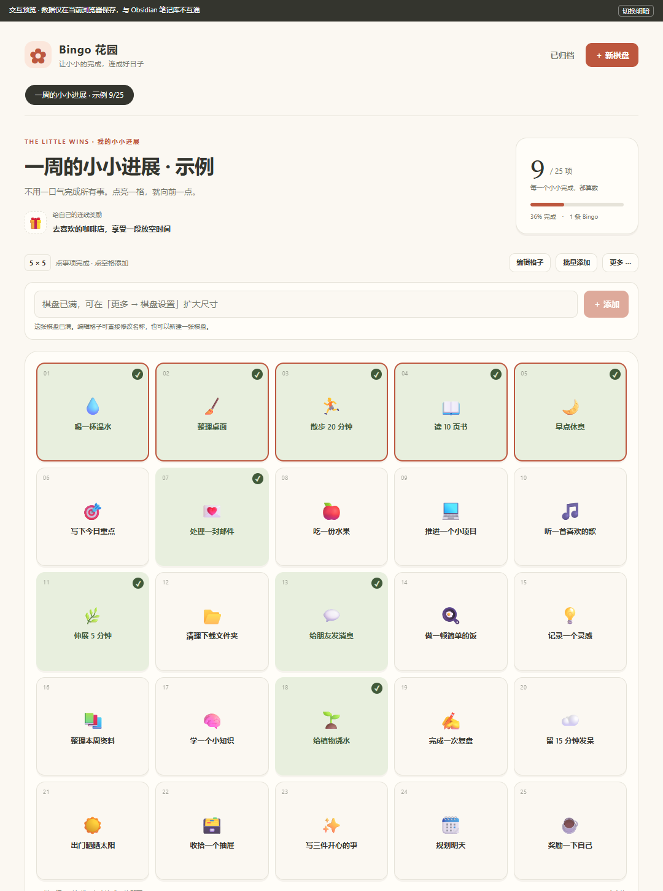
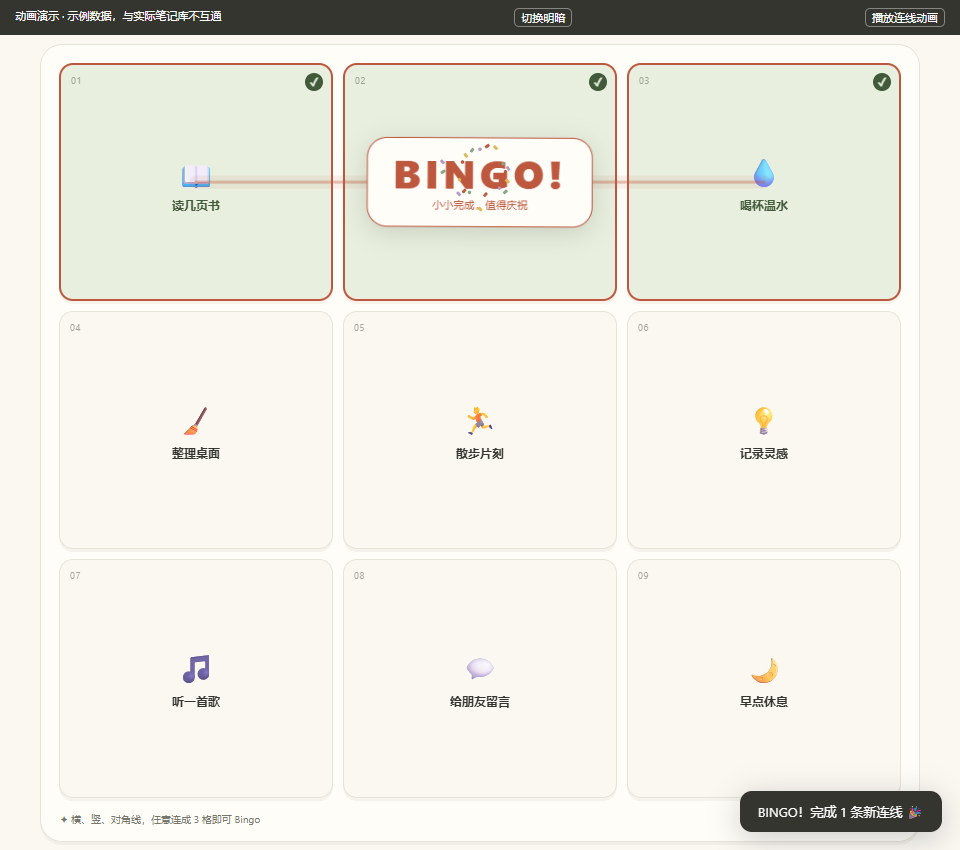

# Bingo Garden-Tasks list

Turn tasks into customizable bingo boards inside Obsidian. Check off small tasks, complete a row, column, or diagonal, and celebrate with a short animation.

[简体中文使用说明](README.zh-CN.md) · [Community listing](https://community.obsidian.md/plugins/bingo-garden) · [Download](https://github.com/dtta520-cpu/bingo-garden/releases/latest)

**Version 1.3.3.** Free and MIT licensed. The interface is in Chinese. No separate account, subscription, server, or Tasks plugin is required.



## Features

- Create multiple boards, each with a custom name, color palette, and optional reward.
- Choose a board size from 3 by 3 to 6 by 6.
- Enter one task at a time or paste multiple lines, including Markdown checklists.
- Edit task titles directly in the grid with Enter and Tab navigation.
- Assign varied icons automatically from task names, or select icons manually.
- Complete rows, columns, and diagonals to trigger a light trail, cell pulses, a Bingo badge, and confetti.
- Archive boards or copy them into a new round while preserving the original history.
- Store each board in an ordinary Markdown file in your vault.



## Installation and updates

Requires **Obsidian 1.14.4 or later**. See the [community listing](https://community.obsidian.md/plugins/bingo-garden) for the current public version and review status.

1. In Obsidian, open **Settings > Community plugins**, browse for **Bingo Garden-Tasks list**, and install it when the release is available there.
2. Enable the plugin, then use the grid icon in the ribbon or the plugin's open-board command in the command palette.

For manual installation, download `main.js`, `manifest.json`, and `styles.css` from the [latest release](https://github.com/dtta520-cpu/bingo-garden/releases/latest). Place these three files directly in `<vault>/.obsidian/plugins/bingo-garden/`, reload Obsidian, and enable the plugin. On macOS, press Command + Shift + Period in Finder to show hidden folders. A [Chinese Mac installation guide](MACOS.md) is also available.

To update an existing installation, replace the same three runtime files and reload Obsidian. Version 1.3.2 changes the display name from Bingo Garden to Bingo Garden-Tasks list. The plugin ID remains `bingo-garden`, and existing boards remain in `Bingo Garden/`; no data migration or folder rename is needed.

Mobile devices need their own installed and enabled copy of the plugin. Syncing notes alone does not necessarily sync `.obsidian` or install plugins. Physical iPhone and Android installation has not yet been verified.

## Using a board

Create a board, choose its size, and add tasks. Use the input above the grid for quick entry: Enter submits the tasks, while Shift + Enter adds a line break. Pasted lines fill empty cells in order. If there is insufficient space, the whole input is kept for editing and existing tasks are not overwritten.

The new-board button and board tabs stay visible while you scroll. A full board also offers a direct button to create another board. After creation, the view returns to the new board's top and shows a confirmation; earlier boards remain available in their tabs.

Click a task in normal mode to toggle completion. In edit mode, change titles directly in cells; Enter or Tab saves and moves forward, Shift + Tab moves backward, and Escape discards the current unsaved title. Open a cell's details to change its icon or notes. Clear the title in the details dialog to empty the cell.

Every cell in a winning line must contain a task and be complete. Empty cells do not count, and there is no automatic free center cell. Only newly completed lines animate. Reopening a completed board does not replay the animation. The system's reduced-motion setting disables animation while preserving the static completion message.

Completed tasks remain on the board. There is no automatic daily or weekly reset. Copy a board into a new round to keep its tasks and reward while resetting completion in the copy, or archive it to keep a historical record. The interface does not permanently delete boards. Rewards are personal reminders; there is no points store, notification service, countdown, or home-screen widget.

## Data, privacy, and synchronization

The plugin makes no network requests, sends no telemetry, and does not read files outside your vault. It uses the Obsidian API to list vault Markdown paths and to read or update board files in `Bingo Garden/`.

Each board's tasks, positions, icons, completion times, reward, and archive state are stored in a `bingo-garden-data` block. Notes outside that block are preserved when saving. Corrupt board data produces an error instead of being overwritten with an empty board. Avoid editing the data block by hand unless you understand its format.

Use your existing vault synchronization tool to sync the `Bingo Garden/` folder. Install the same plugin version on every device, let synchronization finish before editing, and allow changes to upload before switching devices. The plugin does not supply a sync service, confirm sync completion, or merge concurrent offline edits from different devices.

Writes use Obsidian's `Vault.process` to read the current local file before applying a change. Conflicting edits to the same cell preserve the newer content and ask you to edit again. This is local conflict detection, not real-time collaboration. Cross-device conflict resolution depends on your sync tool. Keep independent backups and avoid using multiple sync engines on the same vault.

## Appearance and compatibility

Three color palettes follow light and dark themes. The layout adapts to narrow screens, buttons support keyboard focus and accessible state descriptions, and animations respect reduced-motion preferences. For small screens, 3 by 3 or 4 by 4 boards offer more room for task names. Long names are truncated in cells and can be read in the details dialog.

The runtime uses no Node.js or Electron-specific APIs, and `isDesktopOnly` is `false`. Earlier versions were tested in real Obsidian on Windows and on an Apple Silicon Mac. Physical iPhone, Android, Intel Mac, and end-to-end cross-device synchronization remain unverified. See the [Chinese validation record](README.zh-CN.md#验证说明) for the platforms, versions, and scope of those checks.

## Development

Node.js 18 or later is sufficient to build the plugin; there are no build dependencies to install.

```sh
npm run build
npm test
npm run check
node tests/build-preview.cjs
```

`main.js` is generated from the readable modules in `src/`. At runtime, the only external module is Obsidian's provided API. Browser interaction tests require Playwright and Microsoft Edge; set `PLAYWRIGHT_MODULE` to a separately installed Playwright package if needed.

The standalone preview uses the same interface and board-update code but stores example data in browser local storage. It does not connect to a real Obsidian vault. Save quick-entry and inline-edit drafts before closing the view or restarting the app.

## Release notes and support

Version 1.3.3 makes new-board creation accessible while scrolling and from a full board, and adds a clear success confirmation. Version 1.3.2 updated the display name, CSS overrides, and documentation. See the [changelog](CHANGELOG.md) for earlier releases.

Report reproducible issues through [GitHub Issues](https://github.com/dtta520-cpu/bingo-garden/issues). Include the plugin version, Obsidian version, platform, and steps to reproduce. Use a small example board instead of sharing private notes.

The grid-task idea was inspired by BingoDays. This is an independent implementation and does not use its code, artwork, character assets, or branding.

Licensed under the [MIT License](LICENSE).
